# DealerDomus

**A dealership management system, built by a dealership manager.**

I run car dealerships. I built DealerDomus to fix the gaps I deal with on the floor every day: leads that slip through the cracks, appraisals priced on gut feel, deals you can't see the gross on until accounting books them, and a GM who needs six systems to answer one question.

It covers the whole store in eight connected modules that share one login and one set of data.

## 🎥 Walkthrough video

https://github.com/user-attachments/assets/05672069-7d6e-4771-89d4-358f281e40bc

> The source code is private. Screenshots show demo data only, with no real customers. Happy to walk through the code in an interview.

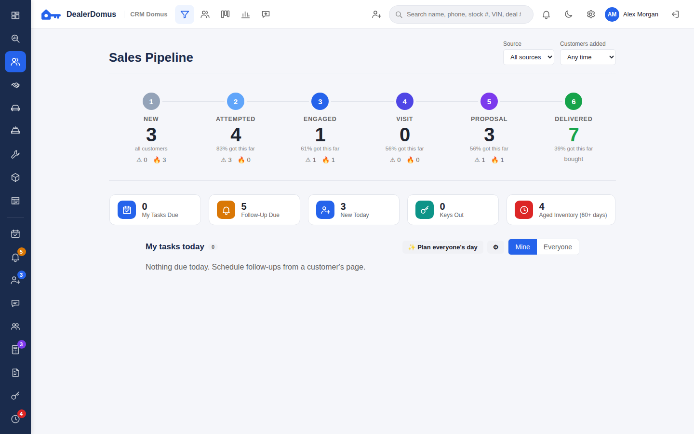

---

## The modules

| Module | What it does |
|---|---|
| **CRM** | Sales pipeline from new lead to delivered, a page per customer, two-way texting and calls, round-robin lead assignment, response-time tracking, duplicate detection, tasks and appointments |
| **Desk** | Deal desking: price, trades, rebates, taxes and fees, F&I products, payments with real amortization, recap, and commissions |
| **Inventory** | Stock, appraisals with VIN decode, and live market pricing: every car against similar cars for sale nearby |
| **Recon** | Reconditioning board in its own tab: every car through each step, time goals, approvals, and days to frontline |
| **Service** | Repair orders, appointments, technician time, and the customer's service history |
| **Parts** | Stock and bins, parts on repair orders, low-stock reorder, counter tickets, and special orders |
| **Accounting** | Double-entry books that post themselves from deals, repair orders, and parts: financial statements, schedules, payables, bank reconciliation, title tracking, and month-end close |
| **Insight** | Manager reports in their own tab: the GM's store overview, sales, F&I, inventory, service and parts, people and goals, and a live "heartbeat" of today's sales floor |

---

## A closer look

### CRM: one page per customer
Road to the sale, every call, text, and note, trades, credit app, and deals in one place.

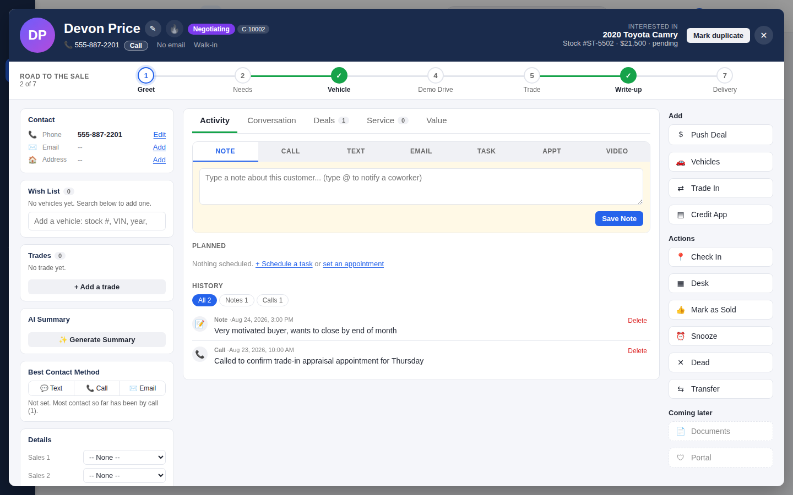

### Desk: deal desking
Price, products, taxes and fees, and the payment, with every line itemized.

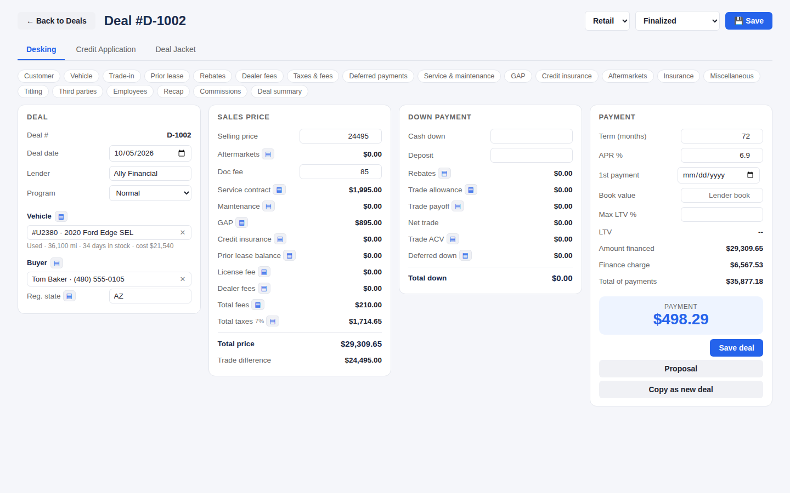

### Inventory: market pricing
Each car's % of market, its rank among similar cars nearby, and a suggested price from the store's own rules (target %, aging, gross floor).

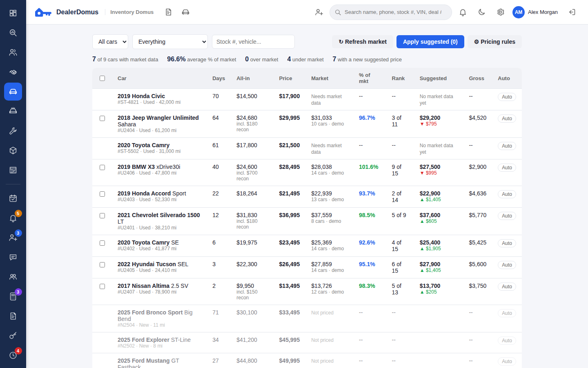

### Appraisals and price to market
VIN decode, equipment, recon, book values, and an appraisal calculator that works back from the internet price.

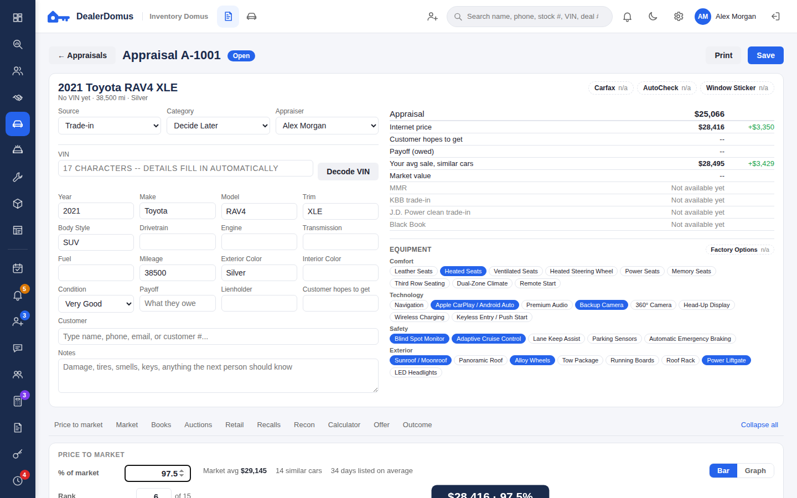

Drag the pin to set the internet price against the market, or switch to a graph of price against miles. Every dot is a real listing you can click.

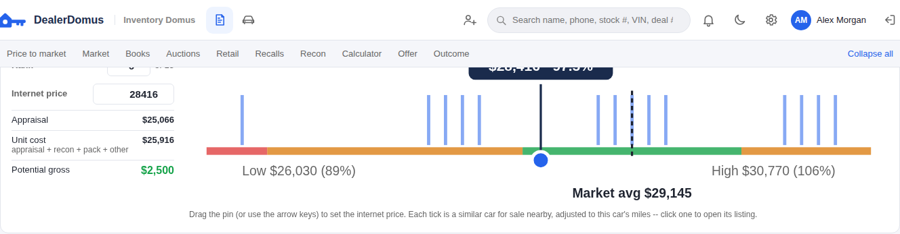
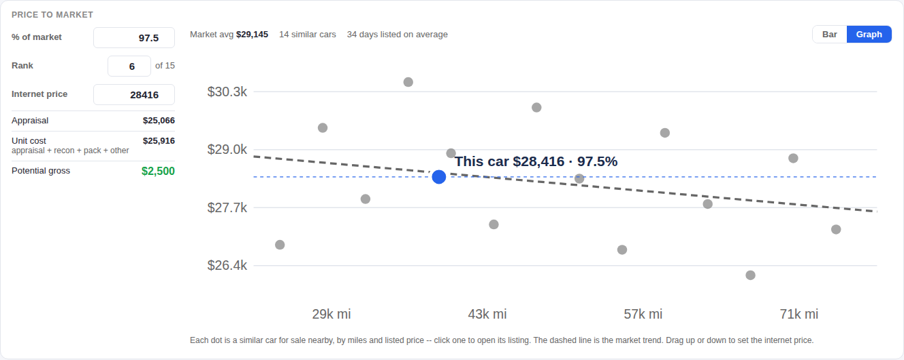

### Recon
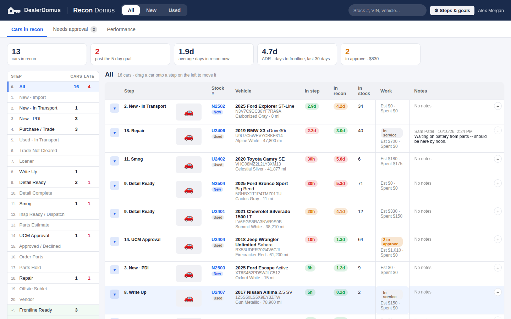

### Service and parts
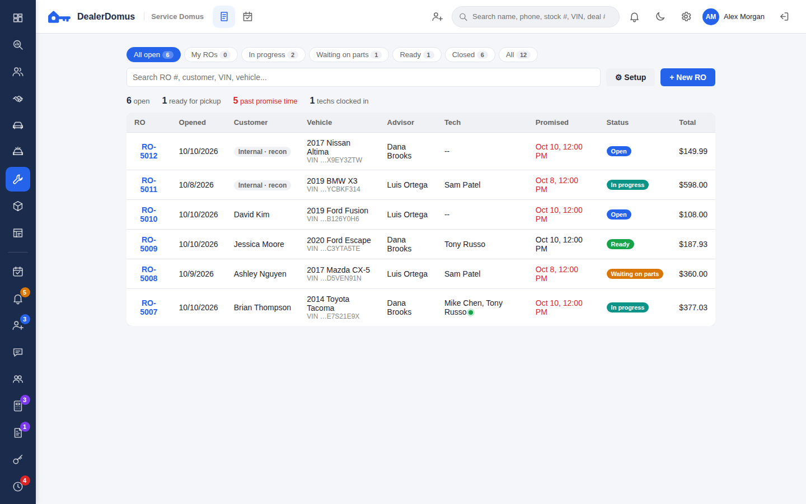
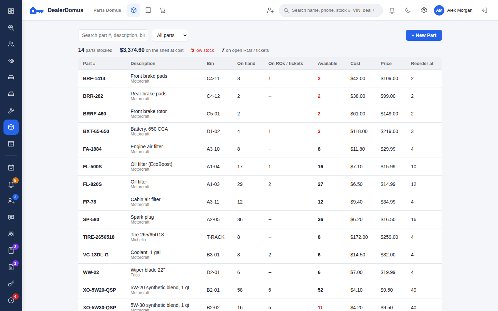

### Accounting: books that post themselves
Deals, repair orders, and parts post to a double-entry general ledger automatically. Statements by department, month and year to date.

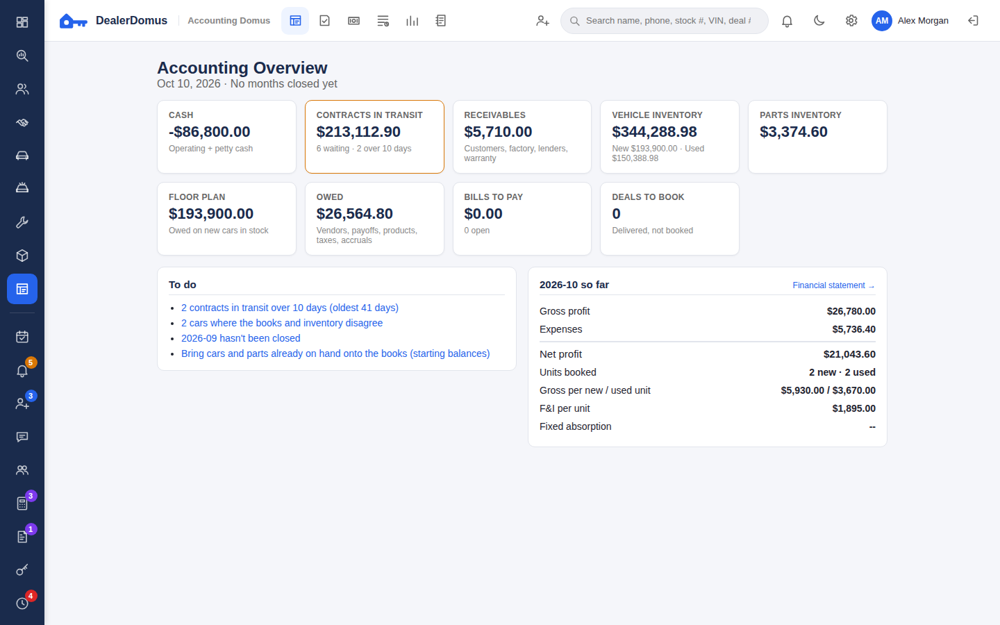
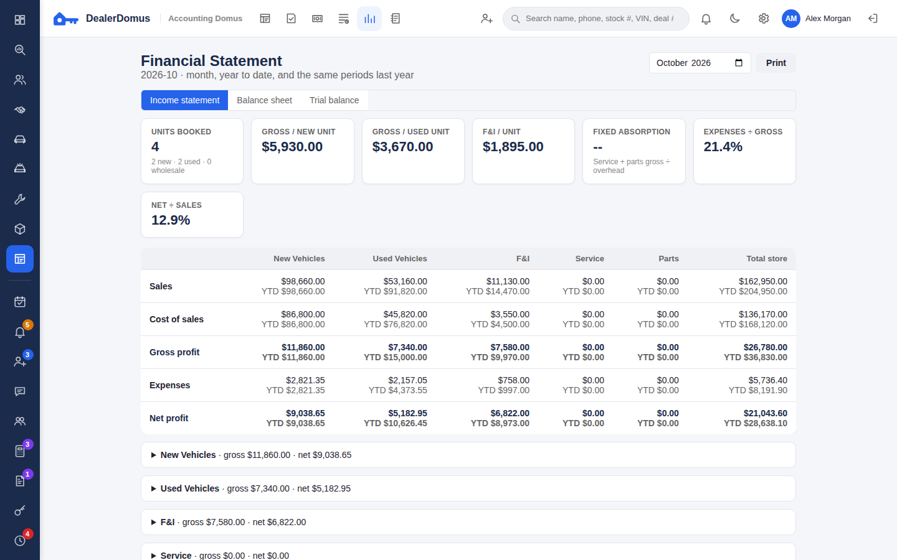

### Insight: the numbers the store runs on
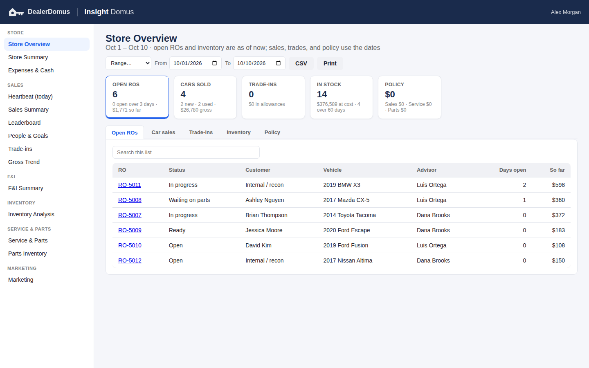
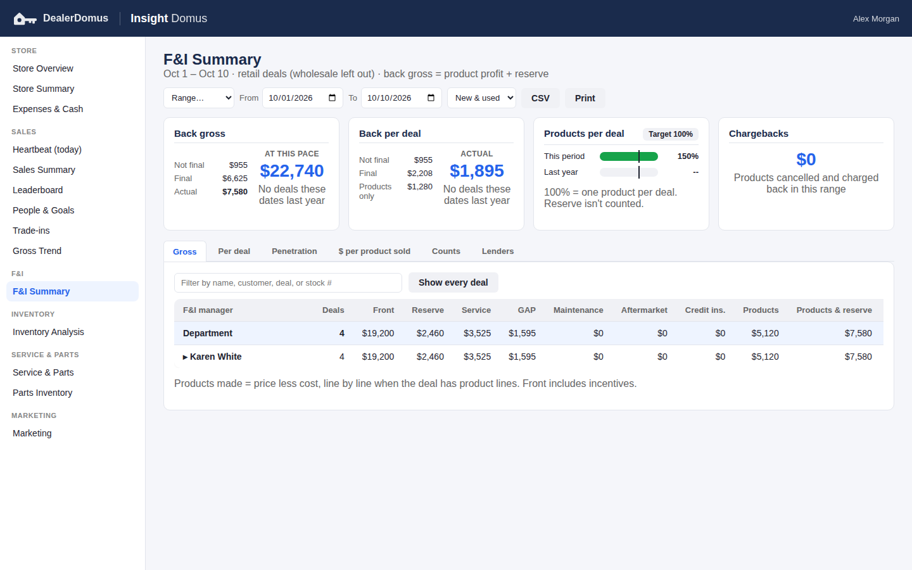
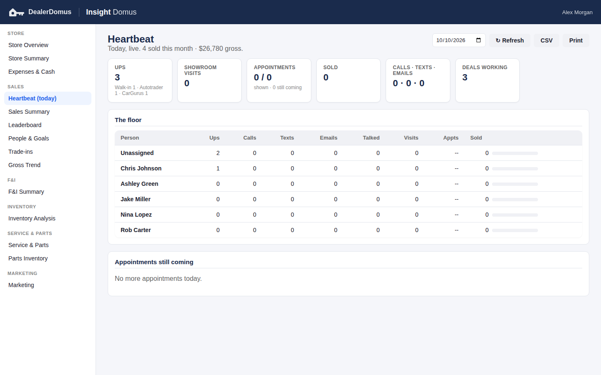

### Dark mode and phone
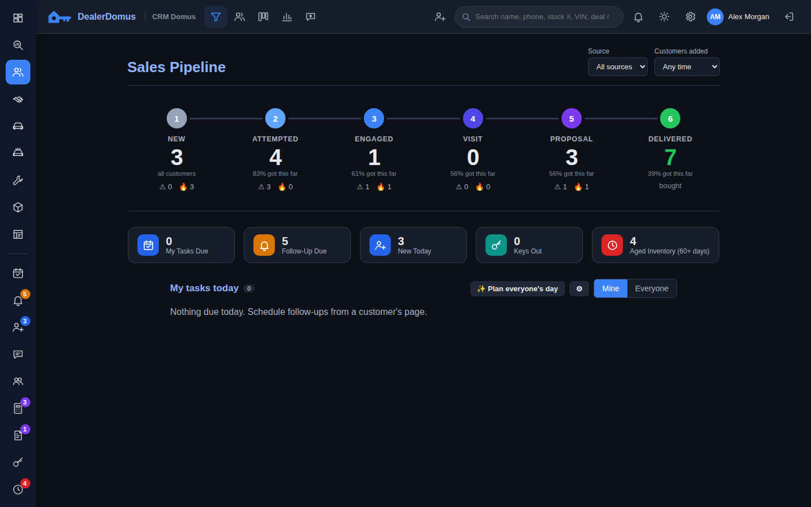 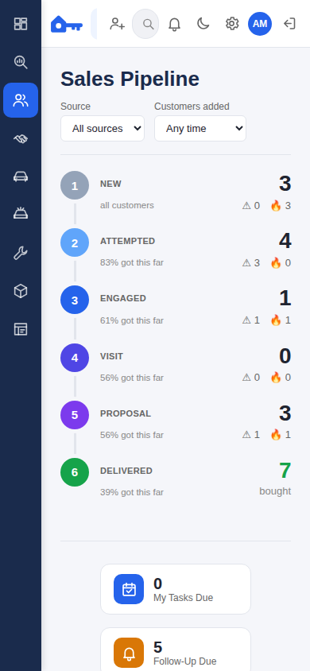

---

## How it's built

- **Backend:** Node.js and Express, PostgreSQL with versioned migrations, a REST API
- **Frontend:** plain JavaScript, HTML, and CSS, no framework, with light and dark themes and phone layouts
- **Integrations:** Twilio (two-way SMS, calls, and call recording), Google Gemini (AI follow-ups and summaries), MarketCheck (market comparables), NHTSA (VIN decode and recalls)
- **Security:** role-based permissions across 10+ roles, an audit log of every change, and encryption of sensitive fields at rest. Social Security numbers are never sent to the AI
- **Quality:** 230+ automated integration tests run against a real database, plus browser checks of every screen
- **Shipped:** 75+ releases, deployed on Render

Built as the sole product owner: I decided what to build from problems I see in real stores, specified and reviewed every feature, and used AI-assisted development to write the code.
